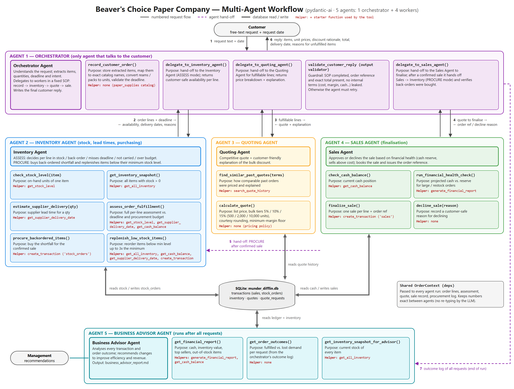

# Beaver's Choice Paper Company — Multi-Agent Quoting, Inventory & Sales System

A five-agent system built with **[pydantic-ai](https://ai.pydantic.dev/)**. It handles customer requests for a paper supply company: it checks inventory, decides when to reorder, prices quotes with bulk discounts, and books sales into a SQLite ledger.



## Agents

| # | Agent | Responsibility |
|---|-------|----------------|
| 1 | **Orchestrator** | The only agent that talks to the customer. Extracts the items, deadline and intent from the request, delegates to the workers in a fixed order (record, inventory, quote, sale), and writes the reply. An output validator checks every reply before it is sent. |
| 2 | **Inventory Agent** | Checks stock, supplier lead times against the deadline, and the procurement budget. After a sale it buys back-ordered stock and replenishes items below their minimum level. |
| 3 | **Quoting Agent** | Prices the order using quote history and bulk-discount tiers, with a margin floor, and explains the price to the customer. |
| 4 | **Sales Agent** | Runs a financial health check, then books the sale or declines it. |
| 5 | **Business Advisor** | Runs after all requests. Analyses every transaction and recommends operational improvements. |

The LLM agents decide what to do and explain the outcome. Deterministic tools built on the starter helper functions produce every number: stock levels, prices, discounts and ledger entries. This keeps customer-facing figures exact.

## Files

| File | Description |
|------|-------------|
| `project_starter.py` | The complete implementation in a single file: the starter helpers, the agents and the evaluation harness. |
| `workflow_diagram.png` | Agent workflow diagram, showing each tool, its purpose and the helper functions it uses. |
| `reflection_report.md` | Architecture explanation, evaluation results and suggested improvements. |
| `test_results.csv` | Results of the evaluation on `quote_requests_sample.csv`. |
| `business_advisor_report.md` | Recommendations from the Business Advisor agent. |
| `evaluation_run_log.txt` | Full console trace of the evaluation run. |
| `quote_requests.csv`, `quote_requests_sample.csv`, `quotes.csv` | Data provided with the starter code. |

## Run it

```bash
python -m venv .venv
.venv/Scripts/activate        # Windows  (macOS/Linux: source .venv/bin/activate)
pip install -r requirements.txt
cp .env.example .env          # then set UDACITY_OPENAI_API_KEY
python project_starter.py
```

The script initialises the database and processes every request in `quote_requests_sample.csv`. It writes `test_results.csv` and `business_advisor_report.md`.

Optional environment variables:
- `OPENAI_BASE_URL` (default `https://openai.vocareum.com/v1`)
- `OPENAI_MODEL_NAME` (default `gpt-4o-mini`)
- `BCP_ANIMATION=0` turns off the animated terminal trace.
- `BCP_TRACE=0` hides the trace completely.
